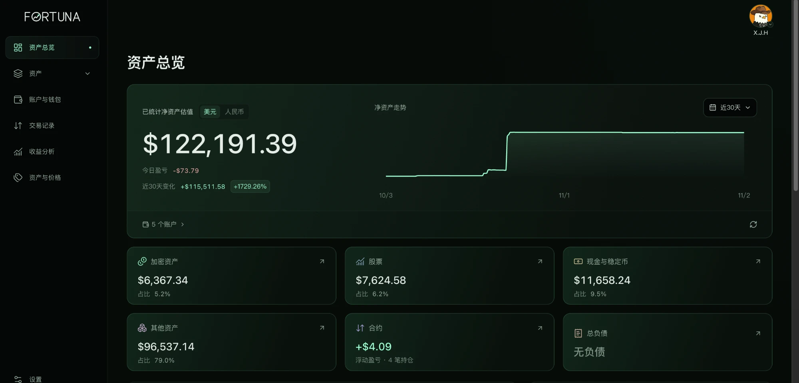
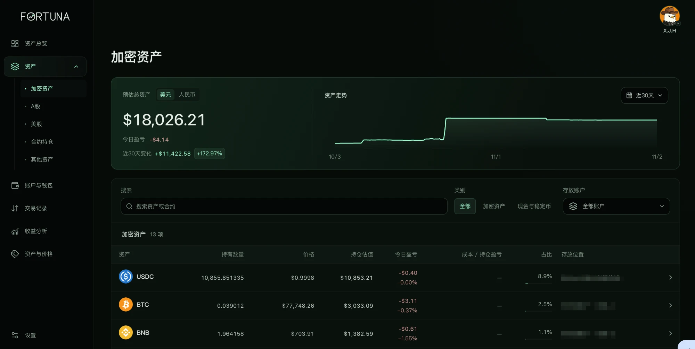

<div align="center">

# Fortuna · 个人投资管理器

**自己部署的个人资产看板：交易所、链上钱包、股票基金现金，一个页面看清净资产。**

  

</div>

自己部署的个人资产看板：把币安、Gate、Bitunix 交易所账户、链上钱包和手动记录的资产（股票、基金、现金、负债）汇总到一个页面，看净资产、持仓、合约、收益和交易记录。数据保存在你自己的服务器上，手机和电脑都能用浏览器访问。

- 交易所和钱包只读：自动更新余额、行情、汇率、交易记录，网页关着也持续更新并记录净资产走势。
- 登录：用户名 + 谷歌验证器动态码，没有密码。
- 数据：SQLite 单文件，在设置页手动导出/导入备份；交易记录永久保留，净值走势按时间自动压缩（三年约 100 MB）。
- 交易所密钥：AES-256-GCM 加密后保存在服务器上。

## 📸 界面预览





## 一条命令安装

在一台全新的 Linux 服务器（Debian / Ubuntu / CentOS / Rocky / Alma，带 systemd，建议 1 GB 以上内存）上，用 root 或 sudo 运行：

```bash
curl -fsSL https://raw.githubusercontent.com/zhong1424535530-pixel/fortuna/main/install.sh | sudo bash
```

脚本会自动完成：安装 Node.js 22、下载并构建、创建系统服务（开机自启、崩溃自动重启）、用 Caddy 提供 HTTPS，最后**在终端直接显示二维码**。用谷歌验证器扫码，输入验证器上的 6 位数字确认，就可以用 `https://服务器IP:8443` 登录了（默认用户名 `qingbaoju`，登录后可在“设置”里改）。

有域名时（域名已解析到服务器，放行 80 和 443 端口），加上域名即可自动申请正式证书：

```bash
curl -fsSL https://raw.githubusercontent.com/zhong1424535530-pixel/fortuna/main/install.sh | sudo DOMAIN=asset.example.com bash
```

没有域名时用自签证书，第一次打开浏览器会提示“不安全”，点“继续访问”即可。别忘了在云厂商安全组放行 8443 端口。

## 日常使用

| 事情 | 做法 |
| --- | --- |
| 升级到最新版 | 重新运行上面的安装命令（资料、登录绑定、密钥口令都保留） |
| 手机丢了 / 重新绑定 | `sudo investment-bind`，所有已登录设备立刻退出 |
| 登录被锁定 | 动态码连错 5 次会锁定该网络地址 24 小时，在服务器上运行 `sudo investment-unlock` 立即解除 |
| 看日志 | `journalctl -u investment-dashboard -f` |
| 资料位置 | `/var/lib/investment-dashboard`（数据库、登录资料） |
| 加密口令 | `/etc/investment-dashboard.env` 里的 `INVESTMENT_MASTER_KEY`，换服务器时要一并带走 |

## 添加交易所

交易所 API 只开**读取**权限，不要开交易、划转、提现，并在交易所里把密钥的 IP 白名单绑定到这台服务器。Gate 和 Bitunix 无法由程序校验权限，请自己确认。

## 安全说明

- 服务只监听 `127.0.0.1`，对外只有 Caddy 的 HTTPS 入口；未登录的所有接口一律拒绝。
- 动态码连续输错 5 次，该网络地址被锁定 24 小时（服务器上 `sudo investment-unlock` 可解除）；登录会话 30 天有效。
- 没有完成谷歌验证器绑定之前，任何人都无法登录。
- 这是个人单用户工具，没有多用户和权限管理；不要把服务直接暴露成无 HTTPS 的 HTTP。

## 检查

项目只在服务器上运行，没有本机开发模式，也没有跳过登录的开关。上线前可运行全部自动检查（需要 Node.js ≥ 22.13）：

```bash
npm ci
npm run check:all
```

手动部署步骤和上线验收清单见 [deploy/README.md](deploy/README.md)；开发过程记录见 [docs/开发日志.md](docs/开发日志.md)。

## 💬 社区

**[Trading 情报局](https://coincia.top/)**：面向全球市场的中文情报社区，始于 2022 年，累计服务会员 800+，聚合 100+ 全球优质 KOL，覆盖美股、Crypto、A 股、链上交易与空投，提供策略统计、自动跟单工具和在线资料库。加入社区免费，入口见 👉 [coincia.top](https://coincia.top/)。

## ☕ 请作者喝杯咖啡

觉得这个工具有用，欢迎赞赏支持，谢谢！

| 微信赞赏 | USDT（TRON / TRC20） |
| :---: | :---: |
|  | `TLow7mj9qfmCbPSJ3JhqoEgqFLBMjYoqP7` |

## 👤 关于作者

**情报局（周 Sir）**，Trading 情报局创始人，负责社区规划、产品方向与技术开发。想交流、合作或加社区，加我微信：


## 🧩 我的其他项目

- **[qingbaoju-bot（情报局跟单宝）](https://github.com/zhong1424535530-pixel/qingbaoju-bot)**：KOL 交易信号跟单工具，监听信号并按规则在 Binance / Bybit 合约账户自动下单，支持模拟盘和实盘。

觉得好用的话，点一下右上角的 ⭐ Star，就是最大的支持。

## 免责声明

本项目只用于个人记录和查看，不构成任何投资建议。使用前请自行评估风险，作者不对数据错误或资金损失负责。

## 许可证

MIT，见 [LICENSE](LICENSE)。
